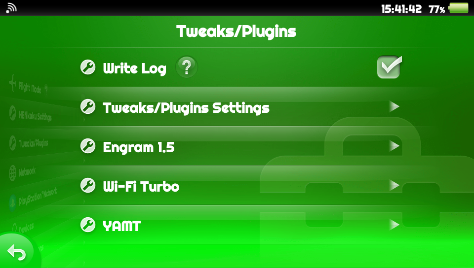
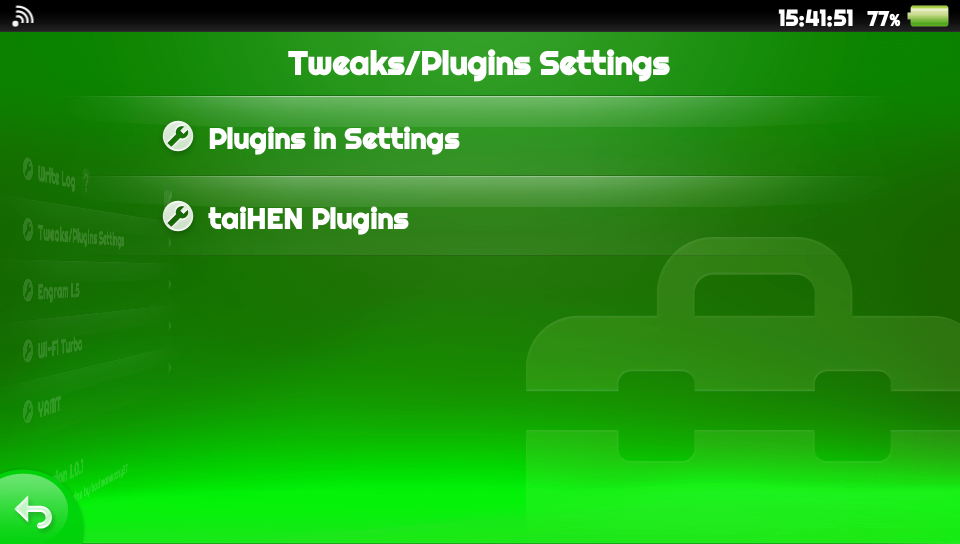
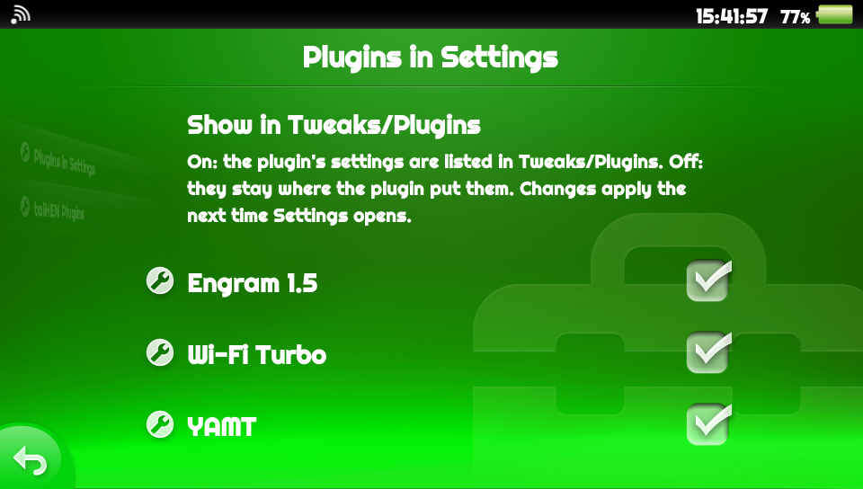
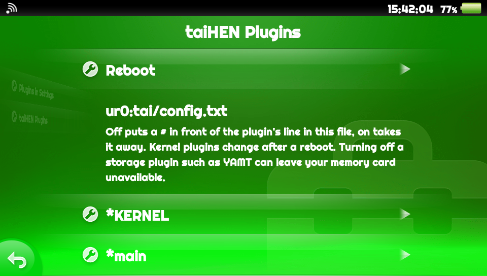

# Tweaks/Plugins

Tweaks/Plugins is a PS Vita plugin that brings your plugins' settings into one convenient place. It's for people who want direct access to the settings pages of their installed plugins without hunting through the Settings menus for wherever each plugin put its page.

It adds a **Tweaks/Plugins** row to the Settings app, straight under **HENkaku Settings**, and moves every plugin's settings page into it. That's how a jailbroken iPhone lists its tweaks together in Settings. HENkaku Settings itself stays where it is.

| Tweaks/Plugins | Tweaks/Plugins Settings |
|---|---|
|  |  |
| **Plugins in Settings** | **taiHEN Plugins** |
|  |  |

Before, those three plugins' pages were spread across three menus: Engram under System, Wi-Fi Turbo under Network, and YAMT under Devices as "Storage Devices".

- **Finds pages by itself.** Each time Settings opens, every Settings page is checked for what plugins have added to it. A newly installed plugin shows up on the first launch, with no setup.
- **Each page in one place.** A page that has moved into Tweaks/Plugins is removed from where its plugin put it.
- **Settings keep working.** Plugins still read and save their own values; only where the page is shown changes.
- **Safe.** If Settings ever crashes right after Tweaks/Plugins has changed the menu, the next launch leaves Settings completely alone.

Tested on retail firmware 3.65 with HENkaku (Ensō), YAMT, Storage Turbo, WiFi Turbo, Sysident and Engram installed.

## Install

### With the installer

Download `tweaks_installer.vpk` from [Releases](../../releases) and install it with VitaShell. Open **Tweaks/Plugins Installer** from the home screen and choose **Install or update**, then restart the Vita.

The installer copies `tweaks.suprx` to `ur0:tai`, puts its line first under `*NPXS10015` in your taiHEN config (keeping a copy of the config first), and takes the line out of anywhere else. It can also check GitHub for a new version and update itself, uninstall the plugin, and show the author's other projects. Its source is in [installer](installer), and it is the [Engram](https://github.com/chazzarchibald-ops/engram-vita) installer with this plugin in it.

### By hand

1. Download `tweaks.suprx` from [Releases](../../releases) and copy it to `ur0:tai/tweaks.suprx`.
2. Add it to your taiHEN config (`ux0:tai/config.txt` if you have one, otherwise `ur0:tai/config.txt`) **as the first line** under `*NPXS10015`, the Settings app:
   ```text
   *NPXS10015
   ur0:tai/tweaks.suprx
   ur0:tai/henkaku.suprx
   ...your other Settings plugins
   ```
3. Reboot, or use HENkaku Settings → Reload taiHEN config, and open Settings.

List it under `*NPXS10015` only. `*NPXS10016` is the Settings pop-up that other apps open for a single page; Tweaks/Plugins does nothing there.

To remove it, delete the line and reboot.

## In Settings

At the top of **Tweaks/Plugins**, above your plugins:

| Row | |
|---|---|
| **Write Log** | Turns `ur0:data/tweaks/log.txt` on or off |
| **Tweaks/Plugins Settings → Plugins in Settings** | A switch for each plugin page found. On: it's listed in Tweaks/Plugins. Off: it stays where its plugin put it. Applies the next time Settings opens |
| **Tweaks/Plugins Settings → taiHEN Plugins** | A **Reboot** button, then your taiHEN config, one page per section (`*KERNEL`, `*main`, `*NPXS10015`, ...), with a switch for each plugin line. Off puts a `#` straight in front of the line (`#ur0:tai/plugin.suprx`); on takes it away |

About the taiHEN switches:

- They edit the config taiHEN is using: `ux0:tai/config.txt` if it exists, otherwise `ur0:tai/config.txt`. The page shows which.
- Only the `#` changes. Nothing else in the file is touched, and lines that are already commented out are listed as off.
- The lines for `henkaku.suprx` and `tweaks.suprx` are never shown or changed.
- Kernel plugins change after a restart; other plugins when their app next starts.
- The file as it was before the first change of each Settings launch is saved as `ur0:data/tweaks/tai_config_backup.txt`.
- **Be careful with storage plugins.** Turning off YAMT or another plugin your memory card depends on can leave `ux0:` unavailable after a restart.

## Config

`ur0:data/tweaks/config.txt` is written with defaults the first time Settings opens. The switches above write to it; it can also be edited by hand:

| Line | |
|---|---|
| `enabled=0` | Turns Tweaks/Plugins off. Settings is back to normal the next time it opens |
| `log=0` | Stops `log.txt` being written |
| `probe=0` | Don't check the other Settings pages up front. Plugin pages are then listed from the launch after you first open the page they're on |
| `move=<id>` | Always put this entry in Tweaks/Plugins, even if it has a custom widget |
| `keep=<id>` | Leave this entry where its plugin put it |
| `name=<id>:<title>` | Show this entry under another name. Built in: `name=id_yamt:YAMT`, since YAMT calls its page "Storage Devices" |

`<id>` is the id from the log, or simply the name you see. Case and punctuation don't matter, and `id_` in front or `_settings` behind can be left off: `keep=yamt`, `move=Wi-Fi Turbo`.

`ur0:data/tweaks/log.txt` carries on from one launch to the next, reboots included, with a dated line at the start of each. Past 64 KB it becomes `log_old.txt` and a new one starts. It lists every plugin page found, with the id to use in `move=`, `keep=` and `name=`.

## What gets moved

A plugin's page is moved when it's a `<setting_list>` or `<link>` that a plugin added:

- **Top menu:** any row that isn't one of Sony's.
- **Other pages:** any entry whose id isn't in Sony's original copy of that page. That includes plugins that replace a whole page with their own copy, as YAMT does with Devices.

These stay where they are:

- HENkaku Settings, and anything with `henkaku` in its id.
- Entries with a `<user_custom>`, a widget drawn by the page the plugin put it on. The log notes these. `move=<id>` moves one anyway.
- Single rows a plugin adds to one of Sony's pages, without a page of its own.

Pages with buttons are moved too. Wi-Fi Turbo's buttons work from Tweaks/Plugins; if another plugin's stop working there, `keep=<id>` puts its page back and the log marks which pages have buttons.

## Safety

- **Crash guard:** `ur0:data/tweaks/building` exists from the moment the plugin starts until the top menu has been on screen for 5 seconds, and records the step it has reached. If Settings closes unexpectedly in that time twice in a row, the plugin creates `ur0:data/tweaks/disabled` and leaves Settings untouched from then on. It takes two, because closing Settings yourself within seconds of opening it looks the same.
- **It gives up as little as it can.** If Settings closed while the other pages were being checked up front, only that check is switched off (`ur0:data/tweaks/noprobe`), and plugin pages are listed after you open them once.
- **Updating gives it a fresh try.** `disabled` and `noprobe` are cleared when another version of the plugin is installed, or when you delete them.
- **The log says where it stopped.** After a launch that ended badly, the next one records which step it had reached, right under that launch in `log.txt`.
- Only the Settings app is affected. A user plugin can't take down anything else.

## Reporting a problem

Please attach these to your [issue](../../issues):

- `ur0:data/tweaks/log.txt`. Each launch starts with a dated `== Tweaks/Plugins` line, and the two lines after it have your real firmware version (even when HENkaku spoofs it) and language.
- Your taiHEN `config.txt`.

## How it works

Settings builds each page from an XML layout, and plugins add their pages by hooking SceSettings' import of `scePafMiscLoadXmlLayout` (`0x3D643CE8` / `0x19FE55A8`) and editing that XML. HENkaku does this, and so do most plugins with a settings page. Tweaks/Plugins hooks the same function.

- **Last in line.** It has to see each page after every other plugin has edited it. taiHEN puts each new hook straight after the first hook in a chain, so Tweaks/Plugins adds two hooks back to back. Every hook added later lands between them, so its second hook stays last, and only that one edits anything. This is why it goes first in the config.
- **Probing.** The top menu loads before any other page, so plugins' pages elsewhere can't be seen directly. While the top menu loads, Tweaks/Plugins finds each page's original XML in the Settings app's memory and sends it through SceSettings' own import stub. Every plugin's hook edits it exactly as when that page opens. Tweaks/Plugins' last hook sees the finished page and notes the entries whose ids aren't in Sony's original. It then returns without letting Settings load it.
- **The top menu** gets a new `<setting_list id="tweaks_plugins">` after HENkaku's row, holding every plugin page found. With no HENkaku row, it goes after Flight Mode.
- **Other pages** lose the entries Tweaks/Plugins now shows.
- **Fallback.** If probing isn't possible (Sony's pages weren't found, another plugin's hook runs after ours, or it's switched off), Tweaks/Plugins remembers plugin pages in `ur0:data/tweaks/cache/` as you open them, and they join the list the next time Settings opens. Without Sony's originals to compare with, a page counts as a plugin's when its title isn't one of Sony's `msg_` text ids.

## Build

You need [VitaSDK](https://vitasdk.org) with the taiHEN stubs (`vdpm taihen`).

```sh
cmake -S . -B build -DCMAKE_BUILD_TYPE=Release
cmake --build build
```

The plugin is `build/tweaks.suprx`.

The installer builds the same way, after the plugin, which it carries:

```sh
cmake -S installer -B installer/build -DCMAKE_BUILD_TYPE=Release
cmake --build installer/build
```

That makes `installer/build/tweaks_installer.vpk`. Its bubble and LiveArea images are drawn by `installer/design/make_art.ps1` (Windows PowerShell, nothing to install) and are already in `installer/sce_sys`.

A release that the installer can update itself from needs two files: `tweaks.suprx` and `tweaks_installer.vpk`, under a tag that is the version number (`v1.1`).

| File | |
|---|---|
| `main.c` | Hooks, probing, and which page gets which edit |
| `regroup.c` | The XML edits, with no hooks or file access |
| `store.c` | Config, log and page cache |

## Credits

- The way plugins add Settings pages comes from [HENkaku](https://github.com/henkaku/henkaku)'s settings page.
- [taiHEN](https://github.com/yifanlu/taiHEN) by Yifan Lu, whose hook chaining makes the load order trick possible.
- PS Vita plugin by badmanwazzy37.

## License

[MIT](LICENSE)
