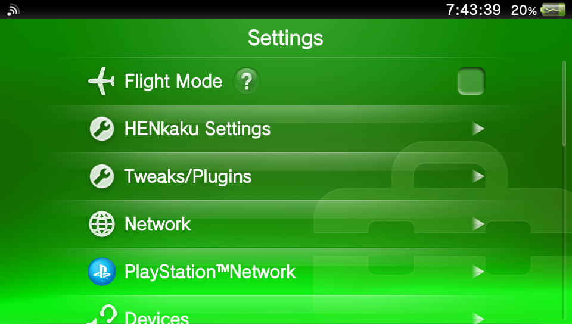
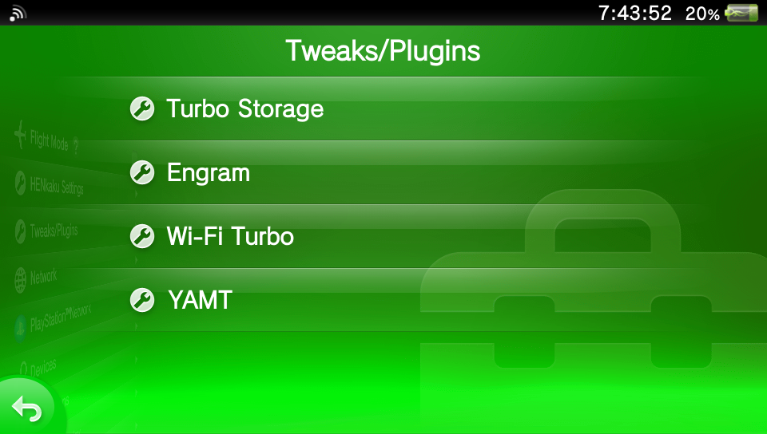

# Tweaks/Plugins

Tweaks/Plugins is a PS Vita plugin that brings your plugins' settings into one convenient place. It's for people who want direct access to the settings pages of their installed plugins without hunting through the Settings menus for wherever each plugin put its page.

It adds a **Tweaks/Plugins** row to the Settings app, straight under **HENkaku Settings**, and moves every plugin's settings page into it. That's how a jailbroken iPhone lists its tweaks together in Settings. HENkaku Settings itself stays where it is.

| Settings | Tweaks/Plugins |
|---|---|
|  |  |

Before, those four pages were spread across three menus: Turbo Storage and Engram under System, Wi-Fi Turbo under Network, and YAMT under Devices as "Storage Devices".

- **Finds pages by itself.** Each time Settings opens, every Settings page is checked for what plugins have added to it. A newly installed plugin shows up on the first launch, with no setup.
- **Each page in one place.** A page that has moved into Tweaks/Plugins is removed from where its plugin put it.
- **Settings keep working.** Plugins still read and save their own values; only where the page is shown changes.
- **Safe.** If Settings ever crashes right after Tweaks/Plugins has changed the menu, the next launch leaves Settings completely alone.

Tested on retail firmware 3.65 with HENkaku (Ensō), YAMT, Storage Turbo, WiFi Turbo, Sysident and Engram installed.

## Install

1. Download `tweaks.suprx` from [Releases](../../releases) and copy it to `ur0:tai/tweaks.suprx`.
2. Add it to your taiHEN config (`ux0:tai/config.txt` if you have one, otherwise `ur0:tai/config.txt`) **as the first line** under `*NPXS10015`, the Settings app:
   ```text
   *NPXS10015
   ur0:tai/tweaks.suprx
   ur0:tai/henkaku.suprx
   ...your other Settings plugins
   ```
3. Reboot, or use HENkaku Settings → Reload taiHEN config, and open Settings.

To remove it, delete the line and reboot.

## Config

`ur0:data/tweaks/config.txt` is written with defaults the first time Settings opens:

| Line | |
|---|---|
| `enabled=0` | Turns Tweaks/Plugins off. Settings is back to normal the next time it opens |
| `move=<id>` | Always put this entry in Tweaks/Plugins |
| `keep=<id>` | Leave this entry where its plugin put it |
| `name=<id>:<title>` | Show this entry under another name. Built in: `name=id_yamt:YAMT`, since YAMT calls its page "Storage Devices" |

`ur0:data/tweaks/log.txt` is rewritten each time Settings opens. It lists every plugin page found, with the id to use in `move=`, `keep=` and `name=`.

## What gets moved

A plugin's page is moved when it's a `<setting_list>` or `<link>` that a plugin added:

- **Top menu:** any row that isn't one of Sony's.
- **Other pages:** any entry whose id isn't in Sony's original copy of that page. That includes plugins that replace a whole page with their own copy, as YAMT does with Devices.

These stay where they are:

- HENkaku Settings, and anything with `henkaku` in its id.
- Entries with a `<button>` or `<user_custom>`. Their handlers belong to the page the plugin put them on, so they would stop working anywhere else. The log notes these.
- Single rows a plugin adds to one of Sony's pages, without a page of its own.

## Safety

- **Crash guard:** `ur0:data/tweaks/building` exists from building the top menu until it has been on screen for 5 seconds. If Settings closes unexpectedly in between, the next launch renames it to `ur0:data/tweaks/disabled` and leaves Settings untouched. Delete `disabled` to try again.
- Only the Settings app is affected. A user plugin can't take down anything else.

## How it works

Settings builds each page from an XML layout, and plugins add their pages by hooking SceSettings' import of `scePafMiscLoadXmlLayout` (`0x3D643CE8` / `0x19FE55A8`) and editing that XML. HENkaku does this, and so do most plugins with a settings page. Tweaks/Plugins hooks the same function.

- **Last in line.** It has to see each page after every other plugin has edited it. taiHEN puts each new hook straight after the first hook in a chain, so Tweaks/Plugins adds two hooks back to back. Every hook added later lands between them, so its second hook stays last, and only that one edits anything. This is why it goes first in the config.
- **Probing.** The top menu loads before any other page, so plugins' pages elsewhere can't be seen directly. While the top menu loads, Tweaks/Plugins finds each page's original XML in the Settings app's memory and sends it through SceSettings' own import stub. Every plugin's hook edits it exactly as when that page opens. Tweaks/Plugins' last hook sees the finished page and notes the entries whose ids aren't in Sony's original. It then returns without letting Settings load it.
- **The top menu** gets a new `<setting_list id="tweaks_plugins">` after HENkaku's row, holding every plugin page found. With no HENkaku row, it goes after Flight Mode.
- **Other pages** lose the entries Tweaks/Plugins now shows.
- **Fallback.** If probing can't find Sony's pages, Tweaks/Plugins remembers plugin pages in `ur0:data/tweaks/cache/` as you open them, and they join the list the next time Settings opens.

## Build

You need [VitaSDK](https://vitasdk.org) with the taiHEN stubs (`vdpm taihen`).

```sh
cmake -S . -B build -DCMAKE_BUILD_TYPE=Release
cmake --build build
```

The plugin is `build/tweaks.suprx`.

| File | |
|---|---|
| `main.c` | Hooks, probing, and which page gets which edit |
| `regroup.c` | The XML edits, with no hooks or file access |
| `store.c` | Config, log and page cache |

## Credits

- The way plugins add Settings pages comes from [HENkaku](https://github.com/henkaku/henkaku)'s settings page.
- [taiHEN](https://github.com/yifanlu/taiHEN) by Yifan Lu, whose hook chaining makes the load order trick possible.
- PS Vita plugin by badmanwazzy37.

## License

[MIT](LICENSE)
